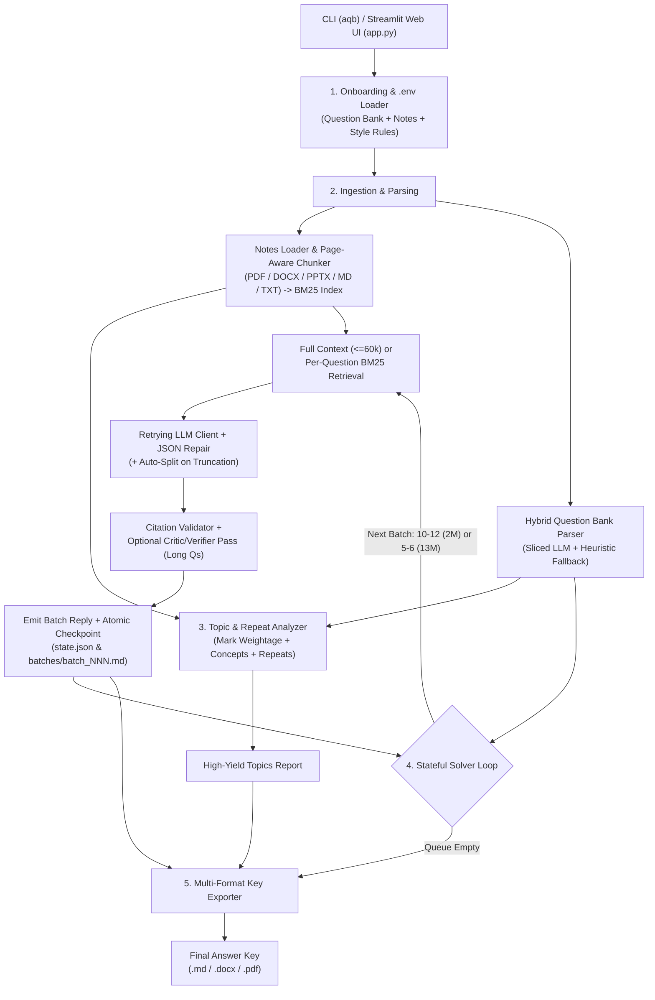

# System Architecture

## 1. Overview

**Autonomous Question Bank (AQB)** is a stateful, batch-oriented agentic application designed to solve academic question banks using user-provided study material (notes, slides, or textbooks) without hallucinating or truncating long responses.

Instead of feeding an entire question bank into a single LLM call (which causes output truncation, lost-in-the-middle attention degradation, and fabricated answers), AQB separates **orchestration** from **generation**:

1. **Controlled Batching**: Solves **10–12 short (2-mark)** questions per turn or **5–6 long (13-mark)** questions per turn, clamped in code.
2. **Strict Grounding & Citations**: Uses full-context injection for compact notes (`≤ 60k` chars) and per-question BM25 retrieval for large corpora, validating every chunk citation (`notes.pdf#p4.C7`) and flagging `[Not found in provided notes]` when coverage is missing.
3. **Deterministic Topic Prioritization**: Computes mark weightage, frequent concepts, and repeated questions in Python code, then enriches each topic with LLM-generated study focus points.
4. **Checkpointed Loop & Fault Recovery**: Atomically persists `state.json` and per-batch Markdown replies after every batch, supports `--resume`, retries transient errors with exponential backoff, repairs malformed JSON, and splits oversized batches automatically if an LLM truncates output.

---

## 2. High-Level Component Diagram

---

## 3. Core Modules (`src/aqb/`)

| Module | Responsibility |
| :--- | :--- |
| `env.py` | Zero-dependency `.env` loader called automatically by CLI and Web UI. |
| `config.py` | Immutable `Settings` dataclass; clamps batch sizes to `10–12` (2M) and `5–6` (13M), configures provider, retries, parse mode, and verifier toggle. |
| `models.py` | Typed domain models: `Question`, `NoteChunk`, `TopicImportance`, `SolvedAnswer` (with `needs_review` / `review_note`), and `SessionState`. |
| `ingestion.py` | Loads `.txt`, `.md`, `.pdf` (PyMuPDF), `.docx` (python-docx), `.pptx` (python-pptx), or raw text; splits notes into boundary-aware, page-labeled chunks; provides per-question BM25 retrieval (`NoteRetriever`). |
| `question_parser.py` | Deterministic heuristic parser (PART A/B/C, UNIT headers, sub-part mark summation, `(OR)` alternatives), line-aligned bank slicer for LLM parsing, notes-heading topic assignment, mark-weighted topic ranking, key-concept extraction, and Jaccard duplicate detection. |
| `prompts.py` | Grounded prompt templates for sliced question parsing, qualitative topic focus points, controlled batch solving, and long-answer verification. |
| `llm.py` | `GeminiClient` (`google-genai`), `OpenAIClient` (OpenAI + `OPENAI_BASE_URL` compatible servers), `RetryingLLMClient` (exponential backoff + jitter, fail-fast on auth errors), tolerant JSON parser/repairer, and offline `MockLLMClient`. |
| `orchestrator.py` | Stateful `AutonomousSolverOrchestrator` with `prepare()`, `load_session()`, `solve_iter()`, `solve_batch()`, and `export()`. |
| `export.py` | Renders `final_answer_key.md`, Word `final_answer_key.docx` (python-docx), and paginated A4 `final_answer_key.pdf` (PyMuPDF `Story`). |
| `cli.py` / `__main__.py` | Interactive and flag-driven CLI (`aqb`) with `--resume`, `--list-sessions`, `--max-batches`, `--verify`, `--docx`, and `--pdf`. |
| `web.py` + `app.py` | Streamlit web app with multi-file uploads, sidebar controls, live batch progress, saved session browser/resume, and MD/DOCX/PDF downloads. |

---

## 4. Anti-Hallucination Guardrails

1. **Hard Batch Caps**: Code-enforced bounds of 10–12 short or 5–6 long questions per reply prevent output truncation and rushed answers.
2. **Closed-World Prompting & Citation Verification**: Only chunk IDs actually provided in the prompt are accepted as valid citations; invalid/invented citations are stripped and flagged for review.
3. **Explicit Unknown Handling**: Uncovered questions output `[Not found in provided notes]` and are collected in a dedicated **Needs Review** section at the end of the answer key.
4. **Omission Retry & Batch Splitting**: If a model skips a question in a batch, the orchestrator automatically re-asks for just the missing IDs; if output JSON is truncated/corrupted, the batch splits in half and retries recursively.
5. **Optional Long-Answer Verifier (`--verify`)**: Runs a fact-checking critic pass on 13-mark answers against the source chunks, revising unsupported claims and recording `review_note`.
