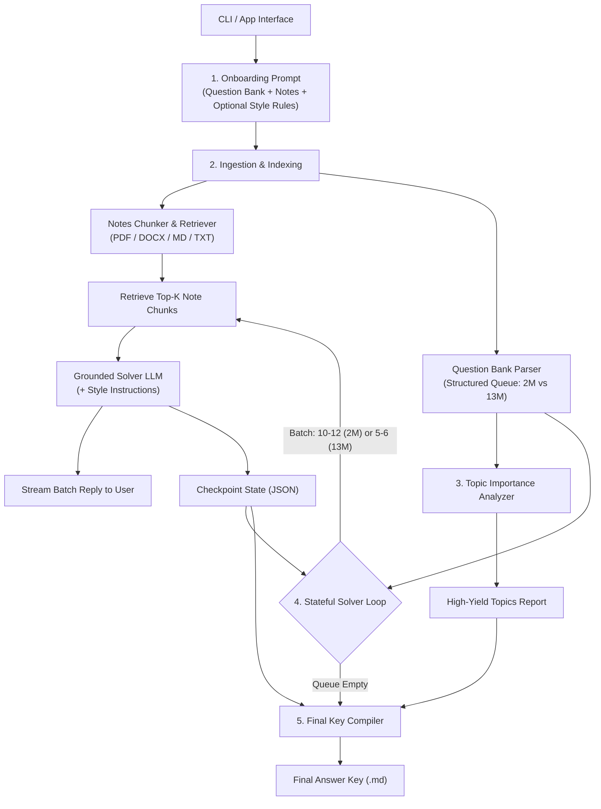

# System Architecture

## 1. Overview

**Autonomous Question Bank (AQB)** is a stateful, batch-oriented agentic system designed to solve academic question banks using user-provided study material (notes/textbooks) without hallucinating or truncating long responses.

Instead of feeding an entire question bank into a single LLM call (which causes output truncation, lost-in-the-middle attention degradation, and fabricated answers), AQB separates **orchestration** from **generation**:

1. **Controlled Batching**: Solves **10–12 two-markers** per turn or **5–6 thirteen-markers** per turn.
2. **Strict Grounding**: Retrieves relevant note chunks per batch and enforces citation-backed answers (`[Not found in provided notes]` if missing).
3. **Topic Prioritization**: Computes mark-weighted topic importance across the question bank to highlight what the student should focus on.
4. **Checkpointed Loop**: Persists progress after every batch so long runs can resume safely and compile into a unified final answer key.

---

## 2. High-Level Component Diagram

---

## 3. Core Modules (`src/aqb/`)

| Module | Responsibility |
| :--- | :--- |
| `config.py` | Runtime configuration (`batch_size_2m` in 10–12, `batch_size_13m` in 5–6, provider, model, temperature). |
| `models.py` | Typed data structures (`Question`, `NoteChunk`, `TopicImportance`, `SolvedAnswer`, `SessionState`). |
| `ingestion.py` | Reads `.txt`, `.md`, `.pdf` (via PyMuPDF), and `.docx` (via python-docx); chunks notes with section/page metadata; provides BM25/keyword-overlap retrieval. |
| `prompts.py` | Prompt templates for Question Parsing, Topic Weightage Analysis, and Grounded Batch Solving. |
| `llm.py` | Provider-agnostic LLM interface supporting Gemini (`google-genai`), OpenAI-compatible APIs, and an offline `mock` provider for deterministic testing. |
| `orchestrator.py` | The main stateful loop: parses inputs, computes high-yield topics, pops batches, retrieves context, invokes the solver, checkpoints state, and exports the final key. |
| `cli.py` | Interactive entry point that prompts at startup for the question bank, notes, and optional formatting instructions. |

---

## 4. Anti-Hallucination Design

1. **Token Budget Isolation**: Capping each reply at 10–12 short answers or 5–6 long answers keeps output tokens well below model limits, preventing mid-answer cutoffs and rushed summaries.
2. **Closed-World Grounding**: Every solver prompt includes only the retrieved note chunks for that batch and instructs the model to cite chunk/page IDs or explicitly state `[Not found in provided notes]`.
3. **Low Temperature (`0.1–0.2`)**: Minimizes creative drift on technical definitions, derivations, and formulas.
4. **Deterministic State Machine**: Python code—not the LLM—tracks which questions are `pending` vs `completed`, guaranteeing zero skipped or duplicated questions.
