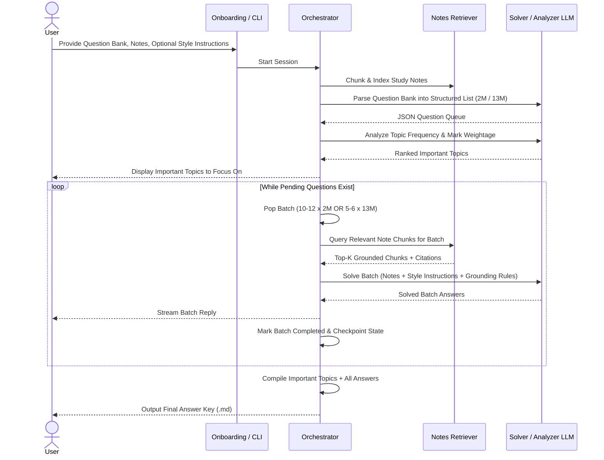

# Agentic Workflow

This document details the exact end-to-end execution flow of the **Autonomous Question Bank** agent.

---

## Workflow Sequence

---

## Step-by-Step Breakdown

### Step 1: Startup Prompts
At the very beginning of a run, the agent prompts the user for:
1. **Question Bank path** (or pasted text).
2. **Study Material / Notes path** (or pasted text).
3. **Optional Answer Style Instructions** (e.g., *"Use bullet points, include Mermaid diagrams for 13-markers, keep 2-markers to 2–3 sentences."*).

### Step 2: Question Parsing & Classification
The parser extracts every question into a normalized schema:
- `id`: Question identifier (`Q1`, `Q2`, ...)
- `marks`: `2` or `13` (extensible to other mark weights)
- `topic`: Inferred sub-topic/lesson area
- `text`: Full question text
- `status`: `pending` | `completed`

### Step 3: Important Topics Extraction
Before or during solving, the orchestrator aggregates mark weightage by topic:
- `total_marks = sum(q.marks for q in topic_questions)`
- `question_count = len(topic_questions)`
- Ranks topics into **High Priority**, **Medium Priority**, and **Quick-Revision (2M-heavy)** so the user knows where to focus study time.

### Step 4: Constant Batch-Solving Loop
The orchestrator loops until `pending_questions == 0`:
1. **Select Batch Type**:
   - Process all pending **2-markers** in batches of **10–12** (configurable, default `10`).
   - Process all pending **13-markers** in batches of **5–6** (configurable, default `5`).
2. **Retrieve Context**:
   - Retrieve the most relevant note chunks for the questions in the current batch.
3. **Generate Batch Reply**:
   - Format the prompt with the batch questions, retrieved note chunks, and user's optional style instructions.
   - Emit the batch reply immediately to the user.
4. **Checkpoint**:
   - Save solved answers and updated `status: completed` to disk (`outputs/<session_id>/state.json`).

### Step 5: Final Answer Key Compilation
Once all batches finish, the orchestrator writes `outputs/<session_id>/final_answer_key.md` containing:
1. Lesson **Important Topics & Focus Guide**
2. **Part A: 2-Mark Questions & Answers** (ordered by ID)
3. **Part B: 13-Mark Questions & Answers** (ordered by ID)
