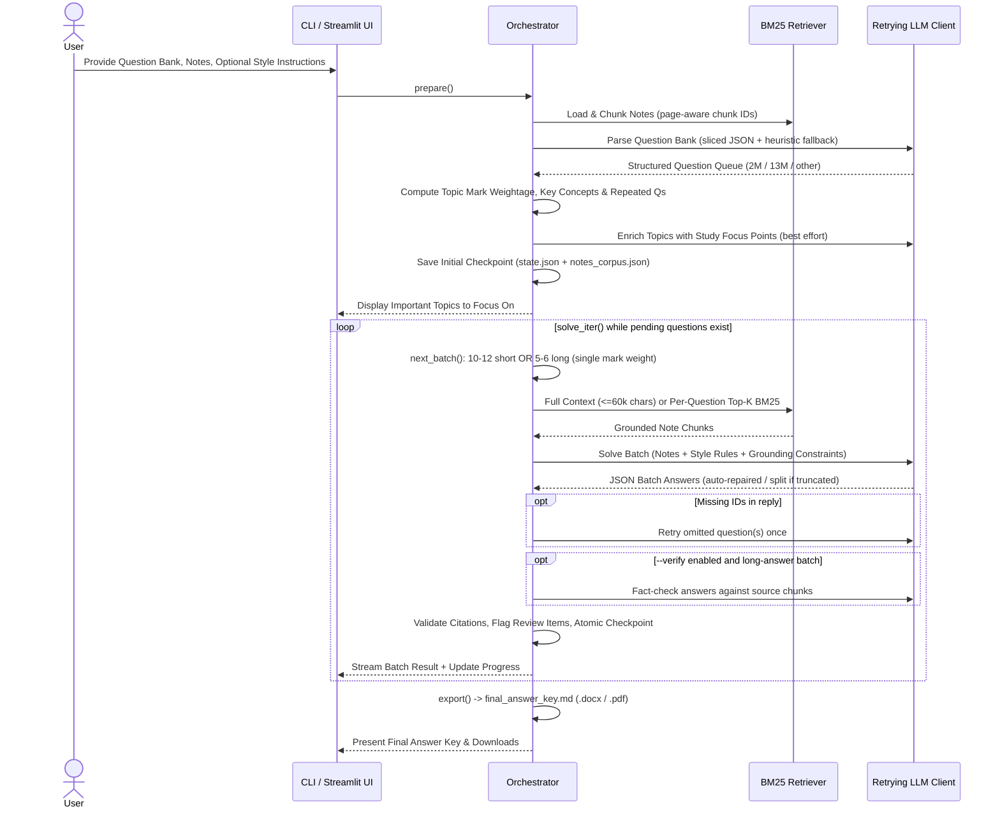

# Agentic Workflow

This document details the end-to-end execution lifecycle of the **Autonomous Question Bank** agent across both the CLI (`aqb`) and Streamlit web app (`app.py`).

---

## Workflow Sequence

---

## Stage-by-Stage Execution

### Stage 1: Onboarding & Input Loading
At startup, the app auto-loads `.env` and prompts for:
1. **Question Bank** — one or more `.pdf`, `.docx`, `.txt`, `.md` files (or pasted text).
2. **Study Material / Notes** — one or more `.pdf`, `.docx`, `.pptx`, `.txt`, `.md` files (or pasted text).
3. **Optional Answer Style Instructions** — formatting/tone rules (never override grounding rules).

The raw question bank and notes corpus are persisted inside `outputs/<session_id>/` so the session is completely self-contained and resumable later.

### Stage 2: Hybrid Question Parsing
- **Auto mode (default)**: Slices long banks along question/header boundaries, extracts questions via JSON-mode LLM calls, and compares against the deterministic heuristic parser (`PART A/B/C`, `UNIT`, sub-part mark summation, `(OR)` alternatives). If the LLM drops >30% of questions or fails, the heuristic parse is used so questions are never silently lost.
- If the parsed questions lack fine-grained topics (e.g., all under one unit), the orchestrator assigns each question to its closest matching heading from the study notes.

### Stage 3: High-Yield Topics & Exam Insights
Before solving begins, the agent outputs:
- **Ranked Important Topics** (`High` / `Medium` / `Low`) ordered strictly by computed mark weightage and question count, enriched with sub-concept focus points.
- **Most Frequently Examined Concepts** (mark-weighted terms/bigrams appearing across multiple questions).
- **Repeated Questions** (near-duplicates detected via Jaccard similarity).

### Stage 4: Checkpointed Batch-Solving Loop
`solve_iter()` loops until `state.has_pending()` is `False` (or `--max-batches` is reached):
1. **Select Batch**: Short answers first (`10–12` per turn), then long answers (`5–6` per turn), keeping one mark value per batch.
2. **Ground Context**: Sends all chunks if total notes are `≤ 60,000` characters; otherwise runs per-question BM25 retrieval so no question in the batch is starved of context.
3. **Generate & Recover**:
   - Retries transient API errors (429/5xx/timeouts) with exponential backoff + jitter.
   - Repairs common JSON formatting errors (fences, prose wrappers, trailing commas, raw newlines) and re-asks once if invalid.
   - Splits the batch in half and recurses if a large batch still produces unusable output.
   - Retries any question ID omitted by the model.
4. **Validate & Checkpoint**: Strips hallucinated chunk IDs, marks uncited or `[Not found in provided notes]` answers with `needs_review=True`, optionally runs the long-answer verifier pass, atomically replaces `state.json`, and saves `batches/batch_NNN.md`.

### Stage 5: Resume & Final Export
- Interrupting at any point (`Ctrl+C`, API quota hit, browser close) preserves all completed batches; resume via `aqb --resume <session_id>` or the Streamlit **Saved sessions** sidebar.
- `export()` compiles the **Important Topics**, **Repeated Questions**, **Part A/B/... Answer Keys**, and **Needs Review** summary into:
  - `outputs/<session_id>/final_answer_key.md`
  - `outputs/<session_id>/final_answer_key.docx` (with `--docx` or Web UI)
  - `outputs/<session_id>/final_answer_key.pdf` (with `--pdf` or Web UI)
